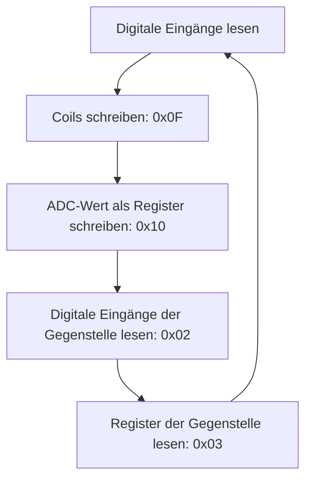

# STM32 Modbus RTU Master über RS485

Dieses Embedded-Projekt zeigt den zyklischen Austausch digitaler Signale und
analoger Messwerte zwischen einem STM32F103C8 und einer Modbus-Gegenstelle.
Die Firmware nutzt USART2 mit DMA, eine CRC16-Prüfung und einen Timer zur
Steuerung der Telegrammfolge.

## Funktionen

- Digitale Eingangszustände als Modbus-Coils übertragen.
- Einen ADC-Wert über Register-Telegramme bereitstellen.
- Digitale Zustände und Registerwerte der Gegenstelle abfragen.
- Zwischen Senden und Empfangen über eine GPIO-gesteuerte RS485-Richtung umschalten.
- Telegramme anhand ihrer CRC16 prüfen und den Ablauf über UART-Callbacks fortsetzen.

Die Anwendung verwendet Slave-Adresse `1` und eine feste Registerbelegung.
Sie eignet sich als Entwicklungsbeispiel für einen konkreten Kommunikationsablauf.

## Technischer Aufbau

| Bestandteil | Verwendung |
|---|---|
| Mikrocontroller | STM32F103C8Tx |
| Kommunikation | Modbus RTU über RS485 |
| UART | USART2 mit DMA für Senden und Empfangen |
| Übertragungsparameter | 9600 Baud, gerade Parität, ein Stopbit |
| HAL-UART-Konfiguration | 9-Bit-Wortlänge mit aktivierter Parität |
| RS485-Richtung | GPIO-Steuerung; Transceiver im Code als MAX485 bezeichnet |
| Ablaufsteuerung | TIM4 und UART-Callbacks |
| Daten | Digitale Ein-/Ausgänge und ADC-Messwert |

## Kommunikationsablauf



Die konkreten Pins und Telegrammadressen stehen in der
[Hardware- und Schnittstellenbeschreibung](docs/HARDWARE.md).

## Projektdateien

| Pfad | Inhalt |
|---|---|
| `firmware/modbus_rtu_7/Core/` | Programmeinstieg, Initialisierung und Interrupts |
| `firmware/modbus_rtu_7/modbus/modbus.c` | Telegrammfolge, GPIO und UART-Callbacks |
| `firmware/modbus_rtu_7/modbus/rtu.c` | Telegrammvorlagen und CRC16 |
| `firmware/modbus_rtu_7/Drivers/` | STM32-HAL- und CMSIS-Komponenten |
| `tools/build.py` | Build mit Arm-GCC ohne IDE |
| [Prüfplan](docs/VALIDIERUNG.md) | Bekannte Funktionsprobleme und Testfälle |
| [Build-Protokoll](BUILD_STATUS.txt) | Dokumentierte Build-Ergebnisse und Warnungen |

## Projekt bauen

### Mit Python und Arm-GCC

Voraussetzungen sind Python 3 und `arm-none-eabi-gcc` mit Newlib/Nano-Specs.
Der Compiler muss im PATH liegen. Alternativ kann `ARM_GCC` auf die
Compilerdatei gesetzt werden. Im Repository-Verzeichnis ausführen:

```powershell
python tools/build.py --profile Debug
python tools/build.py --profile Release
```

Die Firmware-Dateien werden unter `build/<Profil>/` erzeugt. Dieser Ordner
ist durch `.gitignore` ausgeschlossen.

### Mit STM32CubeIDE

1. `firmware/modbus_rtu_7` als bestehendes Projekt importieren.
2. Den internen Projektnamen `modbus_rtu_7` beibehalten.
3. Zunächst Debug und anschließend Release bauen.

Die `.ioc` enthält nicht alle zusätzlichen Registereinstellungen aus `modbus.c`.
Bei einer Neugenerierung müssen diese Einstellungen abgeglichen werden.

## Entwicklungs- und Prüfstand

Debug und Release wurden laut Build-Protokoll vom 03.11.2026 mit Arm-GCC 12.3.1
kompiliert und gelinkt. Compiler- und Linkerwarnungen sind dokumentiert.
Ein vollständiger STM32CubeIDE-Import und Hardwaretests dieser Kopie stehen aus.

Die Fehlerbehandlung wird weiterentwickelt: Timeout/Retry sowie die vollständige
Prüfung von Antwortadresse, Funktionscode, Länge und Modbus-Exceptions fehlen
im vorliegenden Modul. Weitere Punkte zur CRC-Fehlerbehandlung und konsistenten
ADC-Wertübernahme stehen im [Prüfplan](docs/VALIDIERUNG.md).

Für eine nachvollziehbare Hardware-Demonstration sind der tatsächliche Aufbau,
die Gegenstelle und die Messergebnisse zu dokumentieren.

## Herkunft und Lizenzen

[Hinweise zu Komponenten, Codeherkunft und Lizenzen](THIRD_PARTY_NOTICES.md)
gehören zu diesem Projekt.
